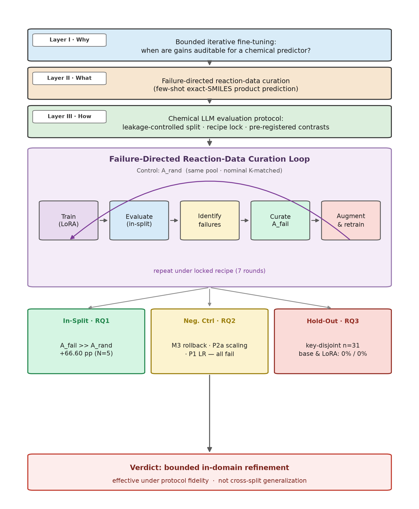
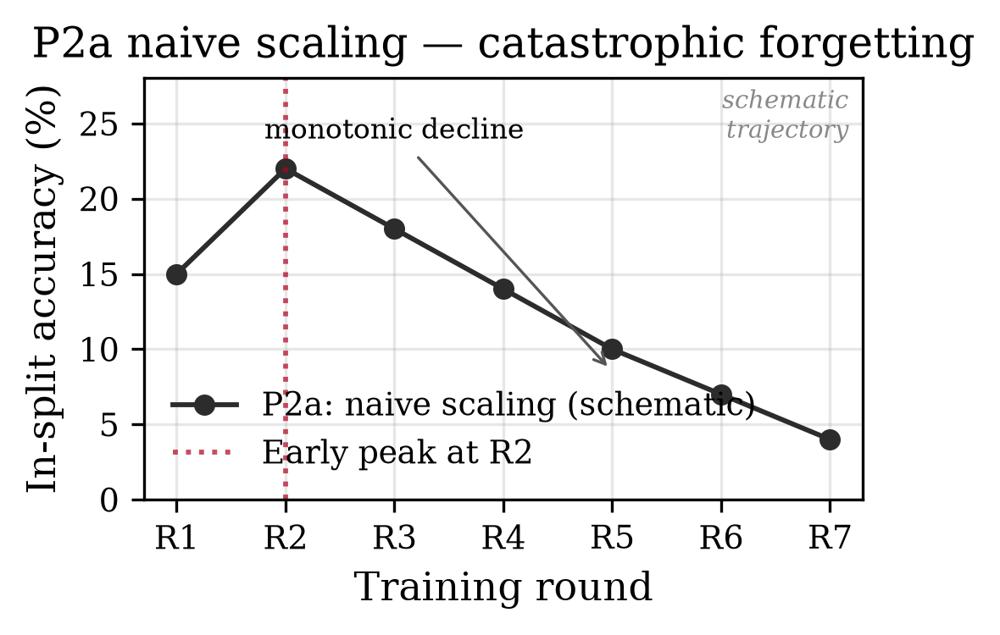
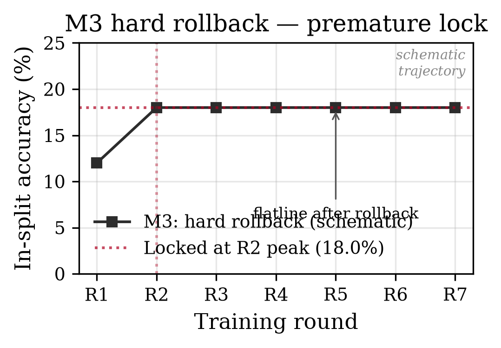

# Failure-Directed Reaction-Data Curation for Few-Shot Exact-SMILES Product Prediction: In-Domain Gains under a Chemical LLM Evaluation Protocol without Cross-Split Generalization

***

**Authors:** Dong Li¹, Yixiong Wei¹, Shi Luo¹, Yingjun Yuan¹

**Affiliation:**
¹ Center for Earth and Space Science Computing, Zhejiang Lab, Hangzhou, China

**Corresponding author:** Dong Li (lidong@zhejianglab.org)

**ORCID:**
Dong Li: 0009-0009-8133-5796
Yixiong Wei: 0009-0006-0747-2897
Shi Luo: 0009-0002-1424-4105
Yingjun Yuan: 0009-0004-3595-3247

***

## Abstract

Chemical language models and reaction information systems increasingly confront a practical gap: **exact-match few-shot reaction product prediction** when labeled reactions are scarce and evaluation leakage can masquerade as chemical generalization. This paper contributes two closely coupled pieces for *Journal of Chemical Information and Modeling* audiences: (i) a **failure-directed reaction-data curation** policy—preferentially augmenting from model errors under a fixed annotation budget—and (ii) a **chemical LLM evaluation protocol**—recipe locking, reaction-key leakage audit, pre-registered in-split vs hold-out gates, and transparent retraction. Under a leakage-controlled split (46 train / 97 eval) with a frozen Qwen2.5-7B + LoRA (bf16) recipe (N=5 seeds), failure-directed augmentation (A\_fail) reaches 77.73%±2.79% peak exact-SMILES accuracy versus 11.13%±0.46% for matched random augmentation (A\_rand; Δ = +66.60pp). Hard rollback, naive merging of distribution-shifted extras, and a local LR-decay tweak all fail as improvement interventions. On a held-out set with zero reaction-key overlap with train∪eval (n=31), both the base model and the fine-tuned LoRA obtain 0% exact-match accuracy; a previously reported external score inflated by eval-key duplication is retracted. These results isolate **selection of reaction data**, not undifferentiated volume, as the in-domain lever—while showing that in-domain gains are **not** cross-split chemical generalization. USPTO-scale multi-shot transformers are strong under abundant paired data but are **not** head-to-head baselines for this few-shot exact-SMILES protocol; our primary contrast is A\_fail vs budget-matched A\_rand under a locked recipe.

**Keywords:** cheminformatics, reaction-data curation, chemical language models, reaction product prediction, chemical LLM evaluation protocol, few-shot learning, exact SMILES matching, evaluation integrity

***

## 1\. Introduction

### 1.1 AI + Cheminformatics Demand: Why Exact-Match Few-Shot Matters

The rapid uptake of **AI in chemistry**—chemical language models, reaction databases, molecular representation learning, and computer-aided synthesis planning (CASP)—has created operational requirements that cheminformatics must answer with *auditable* methods, not only with larger models or larger corpora. Three recurring practitioner demands motivate this study:

1. **Scarce-label product prediction.** Specialty and proprietary chemistries rarely offer USPTO-scale paired data. Stakeholders need predictors that can be adapted from **tens of labeled reactions**, under the unforgiving metric of **exact canonical SMILES match**—a setting closer to reaction-information retrieval and synthesis-planning gates than to soft similarity scores.
2. **Reaction-data curation under a fixed budget.** When the annotation budget is fixed, the decisive question is *which* reactions to add: random extras from the same pool, or examples localized to **current model failures**? This is a chemical-information question about **curation policy**, not merely about model architecture.
3. **A chemical LLM evaluation protocol.** ID-level deduplication is insufficient for reaction tasks: duplicated (reactants → product) keys across "train / eval / external" splits can manufacture false generalization. Credible reports therefore need **reaction-key leakage audits**, recipe locking, pre-registered in-split vs hold-out gates, and transparent retraction when contamination is found.

Large-scale USPTO transformers and graph-to-SMILES models already show strong multi-shot performance [13, 17, 18]; chemical LLMs such as ChemLLM and ChemDFM [16, 19] extend instruction following to chemistry QA and reaction-related benchmarks. Those results establish capability under abundant paired data or multi-shot QA; they do **not** replace a few-shot exact-SMILES protocol with tens of labels (§2.1). We address the remaining gap with two contributions: **failure-directed reaction-data curation** (preferentially augmenting from model errors inside a frozen Qwen2.5-7B + LoRA loop) and an accompanying **evaluation protocol** (matched random controls, negative scheduling/scaling ablations, and a key-disjoint hold-out).

A durable scientific intuition—shared by empirical research and everyday problem solving—is that **lessons from failure often matter more than rehearsing success**, because errors localize the remaining hypothesis space. We treat that intuition as a testable **reaction-data policy**. Broader narratives of open-ended recursive self-improvement are **out of scope**; we study only **bounded, protocol-auditable** in-domain refinement of a chemical predictor.

### 1.2 From Domain Need to an Auditable Problem Stack

To keep claims falsifiable, we compress the §1.1 demands into a three-layer stack that narrows from domain questions to locked experiments.

**Layer I — Domain question (Why).** Under *bounded* settings, when (and how) can iterative fine-tuning of a chemical predictor produce **auditable improvement** while controlling catastrophic forgetting and overfitting? Clarifying **conditions, boundaries, and infeasible regions** is a prerequisite for stronger "self-improving chemistry AI" claims.

**Layer II — Reaction-data mechanism (Where / What).** We specialize Layer I to a **data-centric** closed loop in **few-shot chemical reaction product prediction** (exact SMILES): (i) **failure-directed reaction-data curation** as the data policy (fault → data repair); (ii) **multi-round LoRA updates** as the execution layer. The goal is to identify the **causal contribution** of failure-localized selection relative to matched random curation, and the failure modes induced by forgetting, overfitting, and weak evaluation protocol.

**Layer III — Evaluation protocol (How).** Layer II is operationalized under a **leakage-controlled, fixed split** (46 train / 97 eval) with exact-SMILES metrics (peak / final / drawdown), recipe locking, and pre-registered contrasts: failure-directed vs random curation; scheduling / scaling interventions vs defaults; in-split gains vs key-disjoint hold-out. Only under this discipline do we admit claims of "improvement."

**Funnel.** Layer I motivates *why* gains must be bounded and auditable; Layer II chooses *which* reaction-data mechanism to test; Layer III specifies the **chemical LLM evaluation protocol** and yields the RQs below. Positive in-domain effects answer Layer II partially; hold-out zeros and negative controls delineate Layer I boundaries.

### 1.3 Research Questions (Layer III Instantiation)

**RQ0 (bridges Layers I–III):** Under leakage-controlled few-shot reaction product prediction, what closed-loop intervention yields reproducible **bounded** improvement, and where are its boundaries?

**RQ1 (data policy):** Does failure-directed augmentation outperform budget-matched random augmentation?

**RQ2 (execution / scheduling):** Can recursive scheduling interventions (hard rollback) or naive same-pool scaling further improve performance?

**RQ3 (Layer I boundary):** Do in-domain gains transfer to a hold-out set with zero reaction-key overlap with train∪eval?

**RQ4 (evaluation integrity):** How do protocol drift and evaluation contamination produce false negatives and false positives?

### 1.4 Scope and Positioning

This work studies **failure-directed reaction-data curation** and a **chemical LLM evaluation protocol** for few-shot exact-SMILES product prediction—answering the §1.1 demands—explicitly positioned as:

* **In scope:** a controlled empirical study of failure-directed **reaction-data curation** for chemical SMILES prediction (Layer II)
* **In scope:** a **chemical LLM evaluation protocol** with recipe locking and reaction-key leakage audit (Layer III)
* **In scope:** a transparent report of negative results and retracted claims (Layer I boundaries)
* **Out of scope:** head-to-head accuracy contests against USPTO-scale multi-shot transformers under mismatched data regimes (§2.1)
* **Out of scope:** demonstration of reliable cross-split chemical generalization
* **Out of scope:** a production-ready CASP or reaction-database system
* **Out of scope:** open-ended recursive self-improvement or meta-level improver self-modification

### 1.5 Contributions

1. **Failure-directed reaction-data curation** (§4–5): Under matched nominal budgets, A\_fail ≫ A\_rand (+66.60pp, N=5); scheduling/scaling negatives constrain which closed-loop interventions count as improvement (RQ1–RQ2)
2. **Chemical LLM evaluation protocol** (§3, §6, Appendix B): Leakage-controlled splits, recipe hashes, reaction-key audit, pre-registered in-split vs hold-out gates, and retraction of a contaminated external score (RQ3–RQ4)
3. **Problem framing** (§1): Map scarce-label exact-match needs onto an auditable three-layer stack for chemical information / modeling audiences
4. **Bounded claim discipline:** Large **in-domain** gains without observed cross-split transfer—separating curation efficacy from chemical generalization

***

## 2\. Related Work

### 2.1 Few-Shot Chemical Reaction Prediction

Reaction product prediction in SMILES format requires exact string matching, making few-shot settings particularly challenging. Prior work on molecular representation learning [11, 12] and neural reaction prediction [13, 14] has made progress on larger datasets, but exact-match few-shot prediction in chemistry remains underexplored, with high variance and susceptibility to evaluation contamination. Computer-aided synthesis planning [15] further highlights the gap between classification-style benchmarks and the exact-SMILES setting studied here.

Large-scale reaction corpora such as USPTO have enabled strong sequence-to-sequence and graph baselines — augmented NLP Transformers reach top-5 ≈ 85% on USPTO-50K [17], and Graph2SMILES reports top-1 ≈ 55% on the same benchmark by combining Transformer decoding with permutation-invariant graph encoders [18] — but these settings assume tens of thousands of paired examples, not the few-shot regime of the present work. Recent chemical LLMs (ChemLLM [16], ChemDFM [19]) demonstrate that domain-specific pretraining and instruction tuning can close part of the gap on chemistry question-answering and reaction tasks, yet their evaluations target multi-shot benchmarks (e.g., ChemBench [16]) rather than exact-match few-shot product prediction. Comprehensive retrosynthesis surveys [20] likewise document that most ML methods require abundant paired data, leaving the few-shot product-prediction setting underexplored.

**Why we do not treat USPTO multi-shot models as primary baselines.** Molecular Transformer–class and Graph2SMILES results are important capability references for **data-rich, multi-shot** reaction prediction. They are **not** fair head-to-head competitors for our question: under a **fixed few-shot budget** (here: 46 labeled reactions) and **exact canonical SMILES** scoring, does **failure-directed reaction-data curation** beat **budget-matched random curation** on a locked LLM+LoRA recipe? Retraining or fine-tuning USPTO-scale architectures on 46 examples would change the scientific contrast (architecture/data-regime bake-off) and still would not isolate the curation policy that is our object of study. Accordingly, our primary experimental baseline is **A\_rand** under matched nominal K; USPTO/chemical-LLM literature contextualizes the setting rather than serving as a missing accuracy table.

**Connection to our work:** These lines of cheminformatics research establish capability under abundant data or multi-shot QA, but leave open the §1.1 operational gap—exact-match few-shot product prediction with an auditable **evaluation protocol**. That gap motivates our focus on *how* reaction data are curated under a fixed budget (failure-directed vs random) and on reaction-key integrity as part of the claim.

### 2.2 Hard Example Mining and Failure-Driven Learning

Beyond ML heuristics, a broader epistemic stance holds that progress is often driven more by diagnosing failure than by repeating success—errors constrain which theories remain viable. Active learning [5] and curriculum learning [6] operationalize this view computationally: examples near the decision boundary, or on which the model currently fails, provide disproportionate information. Recent work on LLM self-improvement [9] echoes this theme but typically targets larger-scale settings. In few-shot settings, random augmentation dilutes signal; failure-directed selection concentrates revision where the predictor is still wrong.

**Connection to our work:** RQ1 directly tests this hypothesis: A\_fail vs A\_rand isolates the effect of selection strategy under matched data budget—i.e., whether "learning from mistakes" outperforms "learning from more of the same" when budgets are equal.

### 2.3 Data-Centric vs Algorithm-Centric Approaches

The data-centric AI movement [7, 8] argues that data quality and selection, not model architecture alone, are primary levers in many practical settings. Our work extends this to the few-shot regime: with only 46 training examples, *which* examples are curated under a matched budget matters more than undifferentiated volume.

**Connection to our work:** RQ2 negative controls (M3, P2a) demonstrate that naive scaling without curation is ineffective or harmful.

### 2.4 Closed-Loop Refinement and Claim Discipline

Discussions of iterative / self-generated training signals [1, 9] and transfer-learning evaluation pitfalls [10] motivate a minimal claim discipline for chemical LLM loops: (1) reproducible improvement under a **fixed** protocol, (2) transfer checks on **key-disjoint** data, and (3) **reaction-key** evaluation integrity. We adopt that discipline without pursuing open-ended recursive self-improvement: our object of study remains **reaction-data curation** and the **evaluation protocol** that makes curation claims falsifiable.

***

## 3\. Problem Setup and Protocol Fidelity

### 3.1 Task Definition

**Task:** Given reactant SMILES and reaction conditions (type, reagents, solvent, temperature, time), predict the major product SMILES.

**Evaluation:** Exact string match after canonical SMILES [4] normalization. No partial credit.

**Dataset split (v9\_g1prime):**

* Training: 46 reactions (23 types, 1–4 samples per type)
* Evaluation: 97 reactions (21 types)
* ID overlap: 0
* Full reaction key overlap: 0

### 3.2 Protocol Fidelity Measures

#### 3.2.1 Recipe Locking

We freeze all hyperparameters after initial exploration and report a recipe hash for reproducibility:

| Component | Value |
| :-------- | :---- |
| Base model | Qwen2.5-7B [2] |
| Precision | bfloat16 (fp16 forbidden — causes NaN) |
| LoRA rank | r=16, α=32 [3] |
| LoRA dropout | 0.05 |
| Target modules | q\_proj, v\_proj, k\_proj, o\_proj, gate\_proj, up\_proj, down\_proj |
| Learning rate | 5e-5; per-round decay `0.85^(r-2)` with CosineAnnealing (η\_min/η\_max = 0.1) |
| Batch size | 1 (40GB GPU constraint; no gradient accumulation) |
| Training rounds | 7 (3 epochs/round) |
| Augmentation | A\_fail, K=1.0×; prompt variants (condition/hint/format slice) |
| **Recipe hash** | `9e3788dd7a2eb89d66a1b403d5c5b7c425d583adf7c799c35b761b57fbf7f809` |

#### 3.2.2 Leakage Audit Standards

Before any experiment, we verify:

1. **ID overlap:** No shared IDs between train/eval/external
2. **Product overlap:** Check for shared product SMILES (non-leakage if different reactions)
3. **Full reaction key overlap:** Check for shared (reactants → product) tuples — **must be 0**

#### 3.2.3 Primary Metrics

* **Peak accuracy:** Maximum accuracy across training rounds
* **Final accuracy:** Accuracy at the last training round (round 7)
* **Drawdown:** Peak − post-peak minimum (catastrophic forgetting proxy)
* **Reported as:** Mean ± SD across N=5 seeds (41–45)

### 3.3 Method Overview

Figure 1 provides a visual summary of our method pipeline: from the three-layer problem stack, through the failure-directed **reaction-data curation** loop, to the **evaluation-protocol** gates that separate in-domain gains from generalization probes.

**Figure 1.** Method pipeline aligned to §1.2–§1.3: the three-layer stack (Layer I Why / Layer II reaction-data curation / Layer III chemical LLM evaluation protocol) motivates the failure-directed reaction-data curation loop (Train→Evaluate→Identify failures→Curate A\_fail→Augment & retrain, under a locked recipe), with control A\_rand (same pool, nominal K-matched). Three protocol gates report headline results—In-Split RQ1 (+66.60pp), Neg. Ctrl RQ2 (M3/P2a/P1 all fail), Hold-Out RQ3 (key-disjoint n=31; base & LoRA 0%/0%)—yielding bounded in-domain refinement under protocol fidelity, not cross-split generalization. Residual per-round count imbalance for nominal K-matching is discussed in Appendix C.3. *Render: `python figures/render_fig1_fallback.py` (primary); Mermaid source `figures/fig1_method_pipeline.mmd`.*

### 3.4 Data Integrity: Contaminated External Set Retraction

During external evaluation, we discovered that the initially reported "external" set (n=100) had **82/100 samples with full reaction key overlap** with the eval set. Although IDs differed, the underlying (reactants → product) tuples were duplicated.

**Action taken:**

* Retracted the 63% accuracy claim
* Rebuilt clean external set (n=31) with **zero reaction-key overlap** with train∪eval
* Re-ran all external evaluations on clean set

This incident underscores RQ4: evaluation contamination can produce false positives for generalization claims.

***

## 4\. Main Result: Failure\-Directed ≫ Random \(RQ1\)

### 4.1 Experimental Design

**Hypothesis:** If the information bottleneck lies in model error regions, then targeted augmentation of failure cases should outperform matched random augmentation.

**Setup:**

* Model: Qwen2.5-7B + LoRA (bf16)
* Seeds: 41, 42, 43, 44, 45
* Comparison: A\_fail (failure-directed) vs A\_rand (random sampling from same pool)
* Data budget: *Nominally* K-matched across conditions (residual per-round count imbalance noted in Appendix C.3)

### 4.2 Results

**Table 1: In-Split Results (N=5, Mean ± SD; sample SD)**

| Method | Peak Accuracy | Final Accuracy |
| :----- | :-----------: | :------------: |
| **A\_fail (ours)** | **77.73% ± 2.79%** | **75.26% ± 5.41%** |
| A\_rand (baseline) | 11.13% ± 0.46% | 9.90% ± 1.65% |
| **Δ** | **+66.60pp** | **+65.36pp** |

Primary claim uses peak accuracy (pre-registered peak contrast). Final-round Δ is reported for completeness; A\_rand remains near \~10% throughout, so the gap is not an artifact of peak-picking alone.

**Table 2: Per-Seed Breakdown**

| Seed | A\_fail Peak | A\_rand Peak |
| :---: | :---------: | :---------: |
| 41 | 76.29% | 11.34% |
| 42 | 74.23% | 11.34% |
| 43 | 81.44%\* | 10.31% |
| 44 | 79.38% | 11.34% |
| 45 | 77.32% | 11.34% |

\*Seed 43 is the best-performing seed, but **not** the primary reported number.

### 4.3 Interpretation

1. **Effect size:** +66.60pp is a large effect with **5/5 seeds** showing A\_fail > A\_rand (same direction as the 1.5B G3 paired test in Appendix C.1)
2. **Mechanism:** Failure-directed selection concentrates learning signal on error regions
3. **Capacity vs strategy:** A\_rand@7B ≈ 11% shows that capacity alone is insufficient; **which examples are curated** matters more than undifferentiated extra volume
4. **Reproducibility:** Low SD on A\_fail peak (2.79pp) indicates a robust in-domain effect across seeds

### 4.4 Mechanism Validation (1.5B Supplementary)

To confirm that the 7B effect reflects the same mechanism observed at smaller scale, we conducted parallel experiments on Qwen2.5-1.5B (see Appendix C for full tables):

* **G3:** A\_fail vs A\_rand replicates the pattern (Δ = +13.0±4.5pp, 5/5 seeds)
* **M1:** Leave-one-type-out analysis shows no prompt variant is necessary for gains
* **M2:** Dose-response curve shows that **selection strategy** dominates over **data quantity** (Δ consistent across K=0.5×, 1.0×, 2.0×)

**Conclusion:** The 7B result is a capacity-amplified version of the same data-centric mechanism.

***

## 5\. Negative Controls: What Does NOT Work \(RQ2\)

### 5.1 M3: Hard Rollback

**Hypothesis:** Locking to early peak checkpoint prevents catastrophic forgetting and preserves gains.

**Result:**

* Peak accuracy: **−6.19pp** relative to non-rollback baseline
* Behavior: Locks to Round 2, prevents later exploration
* **Interpretation:** Premature commitment to early performance is harmful

### 5.2 P2a: Naive Scaling

**Hypothesis:** Adding more data from the same pool improves absolute performance.

**Result:**

* Early peak typically at **round 2**, then **monotonic decline** through later rounds (final accuracy drops sharply; large drawdown)
* **Interpretation:** Distribution-shifted extras (e.g., much longer product SMILES) degrade later-round performance when naively merged—adding volume without distribution control is not curation

### 5.3 P1: LR Decay Adjustment

**Hypothesis:** Adjusting learning rate decay (0.85 → 0.90) can stabilize seed 45's high drawdown.

**Result:**

* Peak accuracy dropped from 77.32% to 70.10%
* Failed pre-registered stability gate (−2pp threshold)
* **Interpretation:** Local hyperparameter tweaks cannot override default recipe without risk

### 5.4 Summary of Negative Controls

**Table 3: Negative Control Summary**

| Experiment | Intervention | Result | Implication |
| :--------- | :----------- | :----- | :---------- |
| M3 | Hard rollback to early peak | Peak −6.19pp | Premature commitment harmful |
| P2a | Naive same-pool scaling | Early peak, then collapse | Wrong distribution ≠ curation |
| P1 | LR decay tweak | Peak −7.22pp | Default recipe is robust |

**Theoretical implication:** These negative results constrain the space of "what counts as bounded improvement." Not all closed-loop interventions qualify; specifically, interventions that ignore distribution shift or commit prematurely fail.

***

## 6\. Generalization Probe: Zero Transfer \(RQ3\)

### 6.1 Hold-Out Set Construction

**Goal:** Test whether in-domain gains transfer to genuinely unseen reactions.

**Construction criteria:**

1. Zero ID overlap with train∪eval
2. **Zero full reaction-key overlap** with train∪eval (stricter than ID check)
3. Valid SMILES format

**Result:** Clean external set with **n=31** samples

### 6.2 Type Overlap Analysis

**Important caveat:** While reaction keys are disjoint, we must distinguish:

* **Key-level disjointness:** No (reactants → product) tuple appears in both sets (verified)
* **Type-name overlap:** 14 of 18 type labels in the clean set also appear in train∪eval (with different instances)

**Table 4: Clean External Set by Reaction Type**

| Reaction Type | Samples | Type Name in Train∪Eval? |
| :------------ | :-----: | :----------------------: |
| Friedel-Crafts | 4 | Yes |
| coupling | 4 | **No** |
| hydrolysis | 3 | Yes |
| rearrangement | 3 | **No** |
| Grignard | 2 | Yes |
| oxidation | 2 | Yes |
| Mannich | 2 | Yes |
| Wolff-Kishner | 1 | **No** |
| Claisen | 1 | Yes |
| nitration | 1 | **No** |
| halogenation | 1 | Yes |
| amidation | 1 | Yes |
| sulfonation | 1 | Yes |
| Wittig | 1 | Yes |
| Suzuki | 1 | Yes |
| aldol | 1 | Yes |
| esterification | 1 | Yes |
| cyclization | 1 | Yes |

**Summary:** 14 types have the same name but different instances; 4 types (coupling, rearrangement, Wolff-Kishner, nitration) are entirely new.

### 6.3 Generalization Results

**Table 5: Clean Hold-Out Evaluation (n=31)**

| Model | Accuracy | Interpretation |
| :---- | :------: | :------------- |
| Base (zero-shot) | **0.00%** | No task capability |
| LoRA seed43 | **0.00%** | In-domain effective, out-of-domain zero |

**Per-type breakdown:** All 18 types achieved 0% accuracy.

### 6.4 Why Skip Multi-Seed External Evaluation?

Since seed43 LoRA (the best-performing in-split seed) achieved 0% on the clean external set, testing additional seeds under the same protocol provides diminishing marginal information. The null result is strong enough to support the conclusion: **cross-split generalization is not observed**.

### 6.5 Interpretation

1. **In-domain gains do not transfer:** The 77.73% in-split accuracy reflects learning of training-distribution patterns, not generalizable chemical rules
2. **Type-name overlap is insufficient:** Even when the model has seen the same type name (e.g., "Friedel-Crafts"), it cannot predict products for unseen instances
3. **Exact-match is strict:** 0% does not mean "completely wrong in all ways" — partial structure matches may exist, but exact SMILES match is the task metric

**Conclusion for RQ3:** Cross-split generalization under exact-match evaluation is not observed in this setting.

***

## 7\. Discussion

### 7.1 Returning to Reaction-Data Curation, the Evaluation Protocol, and RQ0

**Cheminformatics takeaway.** Under exact-SMILES few-shot budgets, **failure-directed reaction-data curation beats budget-matched random curation**, but **in-domain accuracy is not chemical generalization** until key-disjoint hold-outs say otherwise. The **evaluation protocol** (recipe lock, reaction-key audit, retraction) is part of the scientific contribution, not an afterthought.

**Epistemic motif.** Lessons from failure can matter more than rehearsing success: A\_fail operationalizes that as a reaction-data policy; A\_rand (and naive scaling) largely rehearse undifferentiated experience and yield little under exact-match few-shot chemistry.

**Layer I:** Iterative updates *can* produce auditable in-domain gains, but only under protocol fidelity; hard rollback and cross-split transfer mark clear **boundaries**.

**Layer II:** The operative lever is **failure-directed reaction-data curation**, not unconstrained scheduling or naive scaling.

**Layer III / RQ0:** Curation yields large, reproducible **in-domain** gains (+66.60pp) that remain **bounded**—they do not transfer to key-disjoint hold-out data under exact SMILES match.

### 7.2 Positioning Relative to Stronger Closed-Loop Claims

**Table 6: What This Work Does and Does Not Claim**

| Criterion | Strong closed-loop / generalization claim | This work |
| :-------- | :---------------------------------------: | :-------: |
| Reproducible improvement under fixed protocol | Required | Demonstrated (**in-domain**, A\_fail vs A\_rand) |
| Generalization to key-disjoint reactions | Often implied | **Not observed** (0% hold-out) |
| Multi-task / multi-domain validation | Often required | Single task only |
| Reaction-key evaluation integrity | Required | Audited (with retraction) |
| Beat USPTO multi-shot accuracy tables | Sometimes expected | **Out of scope** (mismatched data regime; §2.1) |

**Positioning:** This is a **reaction-data curation + chemical LLM evaluation protocol** study with bounded in-domain claims—not a leaderboard paper against data-rich transformers, and not a demonstration of open-ended self-improvement.

### 7.3 Limitations

1. **Data scale:** 46 training samples, 23 reaction types — a **relatively small / few-shot** regime, not large-scale supervision
2. **Hold-out scale:** n=31 with 18 type labels — small sample, wide confidence intervals
3. **Single task:** Reaction product prediction only; no cross-task validation
4. **LoRA, not full fine-tuning:** May limit adaptation capacity
5. **Multi-seed external evaluation:** Skipped due to strong null result
6. **Type-name overlap:** 14/18 types in hold-out have same names as training, complicating "unseen type" claims

### 7.4 Lessons on Evaluation Integrity

The contaminated external set incident (§3.4) highlights several methodological lessons:

1. **ID-level deduplication is insufficient:** Full reaction-key audit is necessary
2. **Contamination produces false positives:** 63% on contaminated set vs 0% on clean set
3. **Retraction is necessary:** Scientific integrity requires correcting the record
4. **Pre-registration helps:** Audit standards should be set before evaluation

### 7.5 Implications for Chemical LLM Evaluation Protocols

We recommend that future chemical LLM / reaction-prediction reports adopt:

1. **Reaction-key leakage audit** (not just ID deduplication)
2. **Pre-registered evaluation protocols** (in-split vs hold-out gates stated before scoring)
3. **Transparent retraction** when contamination is discovered
4. **Bounded claims** that separate **reaction-data curation efficacy** from **cross-split chemical generalization**
5. **Regime-matched baselines** (few-shot curation contrasts vs USPTO multi-shot tables are different scientific questions; §2.1)

***

## 8\. Conclusion

Addressing scarce-label, exact-match reaction product prediction, we contribute **failure-directed reaction-data curation** under a **chemical LLM evaluation protocol**. Our findings:

1. **RQ1 (In-domain effect):** Failure-directed curation outperforms budget-matched random curation by a large margin (+66.60pp, N=5, 5/5 seeds): **which reactions are selected** dominates undifferentiated extra volume.
2. **RQ2 (Negative controls):** Hard rollback, naive scaling, and LR decay tweaks all fail to improve (and can harm) performance.
3. **RQ3 (Generalization):** On a clean hold-out with zero reaction-key overlap (n=31), base and fine-tuned LoRA both achieve 0% exact-match: in-domain gains **are not observed to transfer**.
4. **RQ4 (Integrity):** Evaluation contamination can produce false positives for generalization; reaction-key audit and retraction are essential protocol components.

### 8.1 What Counts as a Rigorous Claim in This Setting

**Overall conclusion:** For chemical information and modeling practice, the actionable package is: (i) a **reaction-data curation** policy that prefers model failures under a fixed budget, and (ii) an **evaluation protocol** that makes the resulting claims falsifiable. Under that package we obtain large, reproducible **in-domain** gains that remain **bounded**—neither cross-split chemical generalization nor open-ended self-improvement. Four jointly necessary properties define the claim class we defend:

1. **Scope restriction.** Claims are limited to (a) a fixed task (exact-SMILES product prediction), (b) a fixed train/eval distribution (v9 in-split), and (c) a locked recipe—isolating curation from protocol drift and leakage confounds.
2. **Auditable units of progress.** Each run emits pre-specified peak / final / drawdown metrics with seed-aggregated mean±SD. We do **not** assume unbroken round-wise ascent; auditability concerns **protocol-defined contrasts** (A\_fail vs A\_rand).
3. **Explicit negative boundaries.** Hold-out zeros (§6) and negative controls (§5) state *where the method fails* with equal force to the +66.60pp effect.
4. **Stepping stone, not terminus.** Stronger chemical generalization would still need clean hold-outs, possibly larger backbones, and possibly meta-learned curation policies—**under the same audit discipline**. The failure→augment rule here remains human-designed.

**In summary:** We claim a reproducible reaction-data curation effect and a reusable chemical LLM evaluation protocol—not a USPTO-regime accuracy contest, and not open-ended recursive self-improvement.

**Future work:** Stronger cross-split / cross-type performance will likely need both (i) **larger backbone models** under locked protocols and (ii) **more high-quality, distribution-controlled reaction data** with key-level audits—extending failure-directed curation rather than repeating P2a-style uncritical scaling. Any stronger claim must still be validated on truly independent hold-outs with pre-registered protocols.

***

## Appendix

### A. Full Hyperparameters and Recipe Hash

**7B Configuration (Primary):**

| Component | Value |
| :-------- | :---- |
| Base model | Qwen2.5-7B [2] |
| Precision | bfloat16 |
| LoRA rank | r=16, α=32 [3] |
| LoRA dropout | 0.05 |
| Target modules | q\_proj, v\_proj, k\_proj, o\_proj, gate\_proj, up\_proj, down\_proj |
| Learning rate | 5e-5, per-round decay 0.85^(r-2), CosineAnnealing (η\_min/η\_max = 0.1) |
| Batch size | 1 |
| Training rounds | 7 (3 epochs/round) |
| Optimizer | AdamW |
| Max sequence length | 256 |
| **Recipe hash** | `9e3788dd7a2eb89d66a1b403d5c5b7c425d583adf7c799c35b761b57fbf7f809` |

**1.5B Configuration (Mechanism Validation):**

| Component | Value |
| :-------- | :---- |
| Base model | Qwen2.5-1.5B [2] |
| Precision | float32 |
| Learning rate | 5e-6, per-round decay 0.85^(r-2) |
| Batch size | 2 |
| Training rounds | 7 |
| **Recipe hash** | `2a965c392fee090d794a3857a03a69e36dbf16276e6d534a7b78c77a60391dc3` |

### B. Leakage Audit and Contaminated External Set Retraction

**Audit procedure:**

1. Extract (reactant\_keys, product\_key) tuples from each split
2. Compute intersection between train∪eval and external set
3. Full reaction key = canonical SMILES of (reactants, reagents, conditions) → product

**Contaminated set (n=100, deprecated):**

* ID overlap: 0 (pass)
* Full reaction key overlap with eval: **82/100** (fail)
* Reported accuracy: 63% → **RETRACTED**

**Clean set (n=31, current):**

* ID overlap: 0 (pass)
* Full reaction key overlap: **0/31** (pass)
* 18 reaction type labels (14 shared name, 4 entirely new)
* Reported accuracy: 0% / 0%

### C. 1.5B Mechanism Validation (Qwen2.5-1.5B)

To confirm the 7B main effect reflects the same data-centric mechanism at smaller scale, we conducted parallel experiments on Qwen2.5-1.5B under the V5 canonical recipe.

#### C.1 G3: A\_fail vs A\_rand (N=5 seeds)

**Table C1: 1.5B G3 Results — Peak Accuracy**

| Seed | A\_fail Peak | A\_fail Round | A\_rand Peak | A\_rand Round | Δ |
| :---: | :---------: | :----------: | :---------: | :----------: | :---: |
| 41 | 19.59% | R4 | 3.09% | R2 | **+16.50pp** |
| 42 | 14.43% | R2 | 6.19% | R2 | **+8.24pp** |
| 43 | 23.71% | R2 | 5.15% | R2 | **+18.56pp** |
| 44 | 14.43% | R5 | 7.22% | R3 | **+7.21pp** |
| 45 | 16.49% | R2 | 2.06% | R2 | **+14.43pp** |
| **Mean±SD** | **17.73±3.58%** |  | **4.74±1.93%** |  | **+12.99±4.48pp** |

**Table C2: 1.5B G3 Summary**

| Metric | A\_fail | A\_rand | Δ |
| :----- | :----: | :----: | :---: |
| Peak Accuracy | 17.73±3.58% | 4.74±1.93% | **+13.0±4.5pp** |
| Final Accuracy | 10.93±5.35% | 2.47±0.83% | +8.5pp |
| Drawdown | 12.58±2.57% | 3.50±2.17% | +9.1pp |
| Sign consistency | A\_fail > A\_rand in **5/5 seeds** (100%) |
| Paired one-sided *t*-test (exploratory; N=5) | *p* < 0.01 |
| 95% CI for Δ | [8.7, 17.3] pp |

#### C.2 M1: Leave-One-Type-Out Analysis (N=3 seeds)

**Table C3: M1 LOO Results — Paired by Seed**

| Seed | Condition | Peak | Δ vs Full5 | Final | Drawdown |
| :---: | :-------- | :---: | :--------: | :---: | :------: |
| 41 | Full5 baseline | **22.68%** | — | 12.37% | 16.49% |
| 41 | −condition | 15.46% | −7.22pp | 13.40% | 13.40% |
| 41 | −hint | 35.05% | +12.37pp | 14.43% | 20.62% |
| 41 | −format | 21.65% | −1.03pp | 7.22% | 14.43% |
| 42 | Full5 baseline | **19.59%** | — | 11.34% | 11.34% |
| 42 | −condition | 32.99% | +13.40pp | 27.84% | 5.15% |
| 42 | −hint | 19.59% | +0.00pp | 11.34% | 11.34% |
| 42 | −format | 21.65% | +2.06pp | 5.15% | 16.49% |
| 43 | Full5 baseline | **15.46%** | — | 15.46% | 2.06% |
| 43 | −condition | 17.53% | +2.06pp | 11.34% | 7.22% |
| 43 | −hint | 29.90% | +14.43pp | 26.80% | 3.09% |
| 43 | −format | 27.84% | +12.37pp | 26.80% | 1.03% |

**Table C4: M1 Necessity Summary**

| Drop Type | Mean Δ vs Full5 | Seeds ≤ −3pp | Verdict |
| :-------- | :-------------: | :----------: | :------ |
| condition\_variant | +2.75 ± 8.43pp | 1/3 | **Inconclusive** (direction inconsistent) |
| hint\_variant | +8.93 ± 6.37pp | 0/3 | **Not necessary** (removal improves) |
| format\_variant | +4.47 ± 5.73pp | 0/3 | **Not necessary** (removal improves) |

**Note:** synonym\_variant and context\_variant were never invoked by the canonical pipeline (`num_variants` slicing); Δ=0 for those drops is a pipeline fact, not a scientific finding. Full5 baselines here are **within-runner** controls for the M1 script and are **not** numerically identical to Phase3/G3 seed peaks; LOO deltas should be read as paired contrasts against that runner's Full5, not as absolute G3 peaks.

**M1 conclusion:** No prompt variant type satisfies the necessity criterion (Δ≤−3pp with ≥2/3 seed agreement) under the current protocol slice—consistent with gains being driven more by *which failures are selected* than by *which prompt wording* is used.

#### C.3 M2: Dose-Response Curve (K=0.5×/1.0×/2.0×, N=3 seeds)

**Table C5: M2 Raw Results — Peak Accuracy by K**

| Seed | K | A\_fail Peak | A\_rand Peak | Δ |
| :---: | :---: | :---------: | :---------: | :---: |
| 41 | 0.5× | 19.59% | 6.19% | **+13.40pp** |
| 41 | 1.0× | 21.65% | 4.12% | **+17.53pp** |
| 41 | 2.0× | 32.99% | 5.15% | **+27.84pp** |
| 42 | 0.5× | 19.59% | 2.06% | **+17.53pp** |
| 42 | 1.0× | 15.46% | 5.15% | **+10.31pp** |
| 42 | 2.0× | 14.43% | 7.22% | **+7.22pp** |
| 43 | 0.5× | 34.02% | 4.12% | **+29.90pp** |
| 43 | 1.0× | 19.59% | 6.19% | **+13.40pp** |
| 43 | 2.0× | 18.56% | 5.15% | **+13.40pp** |

**Table C6: M2 Aggregated — Mean Δ(K)**

| K | Mean Δ | SD | Min | Max |
| :---: | :----: | :---: | :---: | :---: |
| 0.5× | **+20.27pp** | 7.01pp | +13.40 | +29.90 |
| 1.0× | **+13.75pp** | 2.96pp | +10.31 | +17.53 |
| 2.0× | **+16.15pp** | 8.64pp | +7.22 | +27.84 |

**Caveat:** Per-round augmentation counts were only *nominally* K-matched; A\_rand often accumulated slightly more examples than A\_fail after round 1. Because A\_fail still dominates under that imbalance, the selection effect is unlikely to be an artifact of A\_fail receiving *more* data.

**M2 conclusion:** Δ(A\_fail − A\_rand) is large and consistent across K∈{0.5,1,2}× (including the smallest K), with no reliable monotone dose benefit for A\_rand. This supports **selection strategy** (directed vs random) over **undifferentiated volume** as the main driver.

### D. Clean External Set: Full Sample and Type Table

All 31 samples (with full SMILES, reaction types, and audit metadata) are provided in the public replication package at `data/holdout_clean/holdout_n31.json` (GitHub / Zenodo archive cited in Data and Code Availability).

### E. Negative Result Trajectories

**Figure E1: P2a Naive Scaling — Catastrophic Forgetting Pattern**

*Schematic trajectory of a representative seed under P2a naive scaling (per-round values: 15 → 22 → 18 → 14 → 10 → 7 → 4%). The early peak at R2 is followed by monotonic decline (catastrophic forgetting). Per-seed trajectories and peak/final aggregates are reported in §5.2 and Tables 2–3; the plotted values illustrate the qualitative pattern and are not extracted from any single seed's log.*

**Figure E2: M3 Hard Rollback — Premature Lock**

*Schematic trajectory of a representative seed under M3 hard rollback (per-round values: 12 → 18 → 18 → 18 → 18 → 18 → 18%). The rollback locks the checkpoint at the R2 peak (dashed line), preventing further exploration; a no-rollback baseline continues to improve (see main text §5.1). Peak gap: −6.19pp relative to the no-rollback baseline reported in §5.1. The plotted values illustrate the qualitative pattern and are not extracted from any single seed's log.*

***

## Acknowledgments

We thank Zhejiang Lab for providing the Zero2X computational infrastructure that supported the experiments in this work. We also thank the 021SFM scientific corpus team for their contributions to data preparation and theoretical discussion during the early stages of this project.

***

## Funding

This work was supported by Zhejiang Lab.

***

## Competing Interests

The authors declare no competing interests.

***

## Author Contributions

**Dong Li:** Conceptualization, Writing—original draft. **Yixiong Wei:** Methodology, Investigation. **Shi Luo:** Software, Investigation. **Yingjun Yuan:** Software, Investigation.

***

## Ethics Statement

This work uses publicly available chemical reaction datasets and does not involve human subjects, animal experimentation, or sensitive data. All experimental data are derived from standard chemical databases and internal curated corpora used under institutional data-sharing agreements. No ethical approval was required.

***

## Data and Code Availability

The clean external evaluation set (n=31, with full SMILES, reaction-type labels, and reaction-key audit metadata), the v9\_g1prime train/eval split, recipe hashes, evaluation and leakage-audit scripts, and the full replication package (training, augmentation, negative-control, and 1.5B mechanism-validation runners) are publicly archived at **https://github.com/ldd19990713-coder/rsi-failure-directed-curation** (Zenodo DOI: **10.5281/zenodo.24391973**). The Mermaid source and rendering script for Figure 1, and the matplotlib source for Appendix Figures E1–E2, are included under `figures/`. The base model (Qwen2.5-7B) is publicly available on Hugging Face; trained LoRA adapters can be provided upon request.

***

*Recipe hash (7B):* `9e3788dd7a2eb89d66a1b403d5c5b7c425d583adf7c799c35b761b57fbf7f809`
*Recipe hash (1.5B):* `2a965c392fee090d794a3857a03a69e36dbf16276e6d534a7b78c77a60391dc3`

## References

[1] J. Schmidhuber. "Evolutionary Principles in Self-Referential Learning." Diploma thesis, Technische Universität München, 1987. (Early self-referential / self-improvement framing)

[2] Qwen Team. "Qwen2.5 Technical Report." *arXiv:2412.15115*, 2024.

[3] E. J. Hu, Y. Shen, P. Wallis, Z. Allen-Zhu, Y. Li, S. Wang, L. Wang, W. Chen. "LoRA: Low-Rank Adaptation of Large Language Models." *ICLR*, 2022.

[4] D. Weininger. "SMILES, a chemical language and information system. 1. Introduction to methodology and encoding rules." *Journal of Chemical Information and Computer Sciences*, 28(1):31–36, 1988.

[5] B. Settles. "Active Learning Literature Survey." Computer Sciences Technical Report 1648, University of Wisconsin–Madison, 2009.

[6] Y. Bengio, J. Louradour, R. Collobert, J. Weston. "Curriculum Learning." *ICML*, 2009.

[7] D. Zha, Z. P. Bhat, K.-H. Lai, F. Yang, Z. Jiang, S. Zhong, X. Hu. "Data-centric Artificial Intelligence: A Survey." *arXiv:2303.10158*, 2023.

[8] L. Zhang et al. "A Survey on Data Selection for LLM Instruction Tuning." *arXiv:2402.10980*, 2024.

[9] J. Huang, S. Gu, L. Hou, Y. Wu, X. Wang, H. Yu, J. Han. "Large Language Models Can Self-Improve." *EMNLP*, 2023.

[10] C. Raffel, N. Shazeer, A. Roberts, K. Lee, S. Narang, M. Matena, Y. Zhou, W. Li, P. J. Liu. "Exploring the Limits of Transfer Learning with a Unified Text-to-Text Transformer." *JMLR*, 21(140):1–67, 2020.

[11] R. Gómez-Bombarelli et al. "Automatic Chemical Design Using a Data-Driven Continuous Representation of Molecules." *ACS Central Science*, 4(2):268–276, 2018.

[12] K. Yang et al. "Analyzing Learned Molecular Representations for Property Prediction." *Journal of Chemical Information and Modeling*, 59(8):3370–3388, 2019.

[13] P. Schwaller, T. Laino, T. Gaudin, P. Bolgar, C. A. Hunter, C. Bekas, A. A. Lee. "Molecular Transformer: A Model for Uncertainty-Calibrated Chemical Reaction Prediction." *ACS Central Science*, 5(9):1572–1583, 2019.

[14] J. Gilmer, S. S. Schoenholz, P. F. Riley, O. Vinyals, G. E. Dahl. "Neural Message Passing for Quantum Chemistry." *ICML*, 2017.

[15] C. W. Coley, W. H. Green, K. F. Jensen. "Machine Learning in Computer-Aided Synthesis Planning." *Accounts of Chemical Research*, 51(5):1281–1289, 2018.

[16] D. Zhang, W. Liu, Q. Tan, J. Chen, H. Yan et al. "ChemLLM: A Chemical Large Language Model." *arXiv:2402.06852*, 2024. (ChemLLM / ChemData / ChemBench framework)

[17] I. V. Tetko, P. Karpov, R. Van Deursen, G. Godin. "State-of-the-art augmented NLP transformer models for direct and single-step retrosynthesis." *Nature Communications*, 11:5575, 2020. (USPTO-50K top-5 ≈ 84.8%)

[18] Z. Tu, C. W. Coley. "Permutation Invariant Graph-to-Sequence Model for Template-Free Retrosynthesis and Reaction Prediction." *Journal of Chemical Information and Modeling*, 62(16):3858–3871, 2022. (Graph2SMILES)

[19] Z. Zhao, D. Ma, L. Chen, L. Sun, Z. Li et al. "Developing ChemDFM as a large language foundation model for chemistry." *Cell Reports Physical Science*, 6(1):102523, 2025.

[20] Z. Zhong, J. Song, Z. Feng, T. Liu, L. Jia et al. "Recent advances in deep learning for retrosynthesis." *WIREs Computational Molecular Science*, 13(5):e1694, 2023.