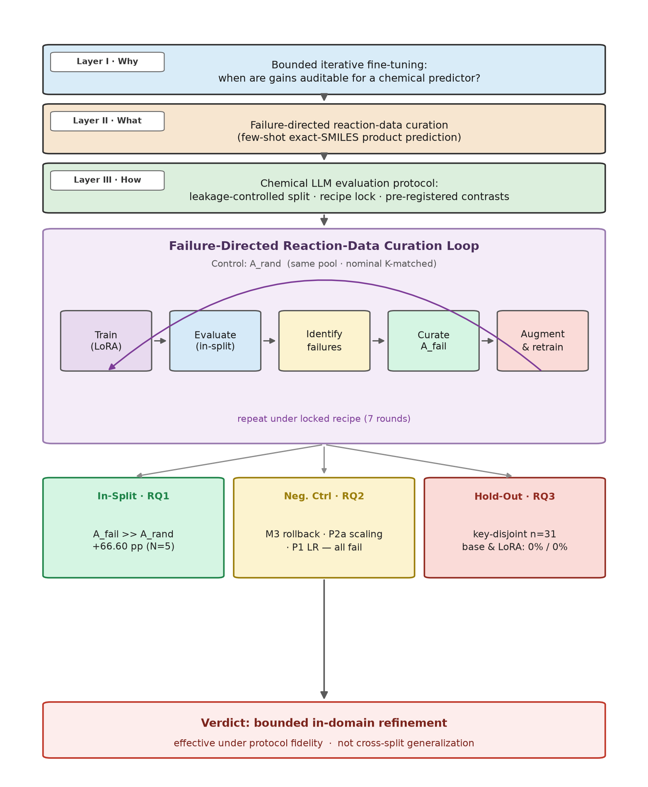
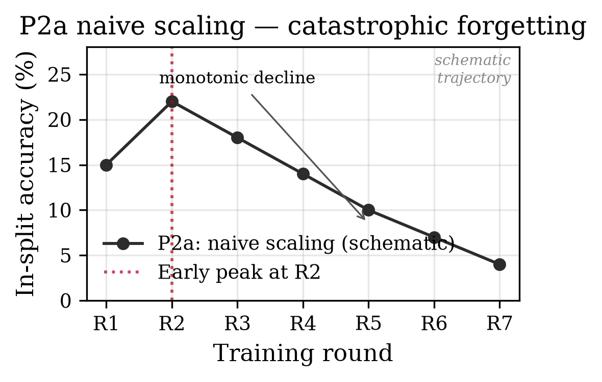
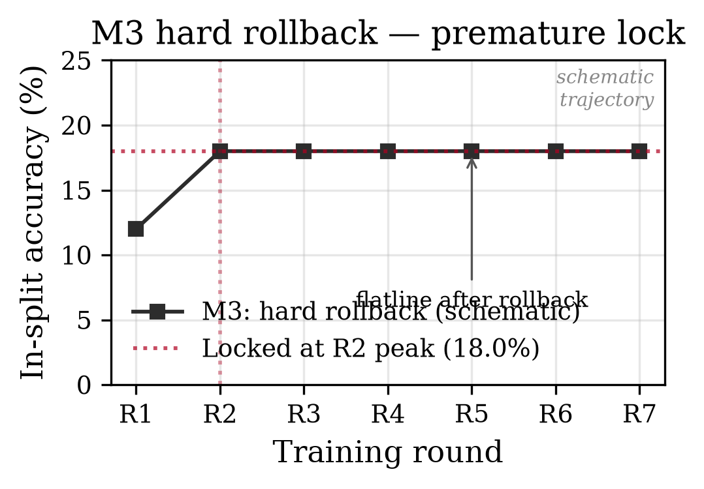

# 少样本精确 SMILES 产物预测中的失败驱动反应数据策展：化学 LLM 评测协议下的域内增益与跨划分零泛化

**Failure-Directed Reaction-Data Curation for Few-Shot Exact-SMILES Product Prediction: In-Domain Gains under a Chemical LLM Evaluation Protocol without Cross-Split Generalization**

***

**作者：** 李冬¹，魏一雄¹，罗实¹，袁英俊¹

**单位：**
¹ 之江实验室地球与空间科学计算研究中心，杭州，中国

**通讯作者：** 李冬（lidong@zhejianglab.org）

**ORCID：**
李冬：0009-0009-8133-5796
魏一雄：0009-0006-0747-2897
罗实：0009-0002-1424-4105
袁英俊：0009-0004-3595-3247

***

## 摘要

化学大语言模型与反应信息系统正面临一个务实缺口：标注稀缺且评测易泄漏时，**精确匹配的少样本反应产物预测**如何可信地改进。本文面向 JCIM 读者贡献两项紧密耦合的内容：（i）**失败驱动反应数据策展**——在固定标注预算下优先由模型错误增广；（ii）**化学 LLM 评测协议**——配方锁定、反应键泄露审计、预注册域内/hold-out 门禁与透明撤回。在泄露受控划分（训练 46 / 评测 97）上，冻结 Qwen2.5-7B + LoRA（bf16），N=5：A_fail 峰值精确 SMILES 准确率 77.73%±2.79%，等预算 A_rand 为 11.13%±0.46%（Δ = +66.60pp）。硬回滚、并入分布偏移样本与局部 LR 调整均未构成有效改进。在与 train∪eval 反应键零重叠的 hold-out（n=31）上，基座与已训 LoRA 均为 0%；污染外集抬高的虚假分数已撤回。结果表明：**反应数据选择**而非无分化堆量才是域内杠杆，且域内增益**不是**跨划分化学泛化。USPTO 量级多样本 Transformer 在充足配对数据下表现强劲，但**不宜**作为本少样本精确 SMILES 协议的一对一 baseline；主对照是锁定配方下的 A_fail vs 等预算 A_rand。

**关键词：** 化学信息学，反应数据策展，化学大语言模型，反应产物预测，化学 LLM 评测协议，少样本学习，精确 SMILES 匹配，评测诚信

***

## 1\. 引言

### 1.1 AI + 化学信息学需求：为何精确匹配少样本至关重要

**AI 与化学的交叉**——化学大语言模型、反应数据库、分子表示学习与计算机辅助合成规划（CASP）——对化学信息学提出了必须**可审计**回答的操作需求，而不能仅靠更大模型或更大语料。下列三项反复出现的实践需求构成本文动机：

1. **稀标注产物预测。** 特种与专有化学很少具备 USPTO 量级配对数据。相关方需要能从**数十条标注反应**适配的预测器，并以**精确规范 SMILES 匹配**为门禁——这比软相似度更接近反应信息检索与合成规划的真实验收标准。
2. **固定预算下的反应数据策展。** 当标注预算固定，关键问题是*增广哪些反应*：同池随机加样，还是优先补齐**当前模型失败**处？这是关于**策展策略**的化学信息问题，而非仅架构问题。
3. **化学 LLM 评测协议。** 对反应任务，仅做 ID 去重不够：train/eval/外集之间重复的（反应物 → 产物）键可制造虚假泛化。可信报告因此需要**反应键泄露审计**、配方锁定、预注册域内/hold-out 门禁，以及发现污染后的透明撤回。

USPTO 规模 Transformer 与 graph-to-SMILES 模型已在多样本设定下表现强劲 [13, 17, 18]；ChemLLM、ChemDFM 等化学 LLM [16, 19] 也将指令跟随扩展到化学问答与反应相关基准。这些结果确立了充足配对数据或多样本问答下的能力；它们**不能替代**仅数十条标签的少样本精确 SMILES 协议（§2.1）。我们以两项贡献填补剩余缺口：**失败驱动反应数据策展**（在冻结 Qwen2.5-7B + LoRA 闭环中优先由模型错误增广），以及配套的**评测协议**（等预算随机对照、调度/扩容负消融与键不相交 hold-out）。

科学研究与日常解题中有一常青直觉：**败中取法往往比重复成功更关键**，因为错误标出仍须修正的假设空间。我们将其作为可检验的**反应数据策略**。开放式递归自我改进叙事**不在本文范围**；我们只研究化学预测器上**有界、协议可审计**的域内精炼。

### 1.2 从领域需求到可审计问题栈

为使主张可证伪，我们将 §1.1 的需求压缩为三层问题栈，由领域问题逐步收窄到锁定实验。

**第一层 · 大方向（Why）。** 在**有界**设定下，化学预测器的迭代微调如何（以及能否）产生**可审计改进**，并控制灾难性遗忘与过拟合？澄清**条件、边界与不可行区域**，是任何更强「自我改进化学 AI」主张的前提。

**第二层 · 反应数据机制（Where / What）。** 将第一层收窄到**数据中心**闭环，场景为**少样本化学反应产物预测**（精确 SMILES）：（i）**失败驱动反应数据策展**作为数据策略（故障 → 数据修复）；（ii）**多轮 LoRA 更新**作为执行层。目标是弄清失败局部化选样相对等预算随机策展的**因果贡献**，以及遗忘、过拟合与薄弱评测协议导致的失效模式。

**第三层 · 评测协议（How）。** 在**无泄露、固定划分**（训练 46 / 评测 97）下，以精确 SMILES 的峰值/末轮/回撤为主指标，冻结配方，预注册对照：失败定向 vs 随机策展；调度/扩容干预 vs 默认；域内增益 vs 反应键不相交 hold-out。唯有在此纪律下，才承认「改进」主张。

**漏斗关系。** 第一层说明增益为何必须有界且可审计；第二层选定要检验的反应数据机制；第三层规定**化学 LLM 评测协议**并导出下文 RQ。域内正效应部分回答第二层；hold-out 零结果与负对照刻画第一层边界。

### 1.3 研究问题（第三层操作化）

**RQ0（贯通三层）：** 在泄露受控的少样本反应产物预测中，何种闭环干预能产生可复现的**有界**改进，其边界在哪里？

**RQ1（数据策略）：** 失败驱动增广是否优于预算匹配的随机增广？

**RQ2（执行/调度）：** 递归调度类干预（硬回滚）或同池朴素扩容能否进一步提升？

**RQ3（第一层边界）：** 域内增益能否转移到与 train∪eval 反应键不相交的 hold-out？

**RQ4（评估诚信）：** 协议漂移与评测污染如何导致假阴性/假阳性？

### 1.4 范围与定位

本工作研究少样本精确 SMILES 产物预测上的 **失败驱动反应数据策展** 与 **化学 LLM 评测协议**——回应 §1.1 需求——明确定位为：

* **范围内：** 面向化学 SMILES 预测的失败驱动**反应数据策展**受控实证（第二层）
* **范围内：** 含配方锁定与反应键泄露审计的**化学 LLM 评测协议**（第三层）
* **范围内：** 负结果与撤回的透明报告（第一层边界）
* **范围外：** 与 USPTO 量级多样本 Transformer 在错配数据体制下的一对一准确率竞赛（§2.1）
* **范围外：** 可靠跨划分化学泛化的演示
* **范围外：** 生产就绪的 CASP 或反应数据库系统
* **范围外：** 开放式递归自我改进或元层 improver 自我改写

### 1.5 贡献

1. **失败驱动反应数据策展**（§4–5）：名义等预算下 A_fail ≫ A_rand（+66.60pp，N=5）；调度/扩容负结果约束何种闭环算改进（RQ1–RQ2）
2. **化学 LLM 评测协议**（§3、§6、附录 B）：泄露受控划分、配方哈希、反应键审计、预注册域内/hold-out 门禁，以及污染外集分数撤回（RQ3–RQ4）
3. **问题框架**（§1）：将稀标注精确匹配需求映射为面向化学信息/建模读者的可审计三层栈
4. **有界主张纪律：** 大幅**域内**增益但不观测到跨划分迁移——把策展效力与化学泛化分开

***

## 2\. 相关工作

### 2.1 少样本化学反应预测

SMILES 格式的反应产物预测要求精确字符串匹配，使少样本设定尤为挑战。先前关于分子表示学习 [11, 12] 与神经反应预测 [13, 14] 的工作在较大数据集上取得进展，但精确匹配少样本预测在化学领域仍探索不足，具有高方差与易受评测污染的特性。计算机辅助合成规划 [15] 进一步凸显了分类式基准与本文精确 SMILES 设定之间的差距。

USPTO 等大规模反应语料催生了强劲的 seq2seq 与图基线——增广 NLP Transformer 在 USPTO-50K 上达到 top-5 ≈ 85% [17]，Graph2SMILES 将 Transformer 解码与置换不变图编码器结合，在同基准上 top-1 ≈ 55% [18]——但这些设定依赖数万级配对样本，与本文的少样本机制截然不同。近期化学 LLM（ChemLLM [16]、ChemDFM [19]）展示了领域定向预训练与指令微调在化学问答与反应任务上的收益，但其评测集中于多样本基准（如 ChemBench [16]），而非精确匹配少样本产物预测。逆合成综述 [20] 同样指出，多数 ML 方法依赖丰富配对数据，少样本产物预测仍属研究空白。

**为何不以 USPTO 多样本模型作为主 baseline。** Molecular Transformer 类与 Graph2SMILES 结果是**数据充足、多样本**反应预测的重要能力参照，但**不是**本文问题的公平一对一对手：在**固定少样本预算**（本文 46 条标注反应）与**精确规范 SMILES** 计分下，**失败驱动反应数据策展**是否优于**等预算随机策展**（锁定 LLM+LoRA 配方）？在 46 条样本上重训/微调 USPTO 规模架构会改变科学对照（变成架构/数据体制比拼），仍无法隔离我们真正关心的策展策略。因此，主实验 baseline 是名义匹配 K 下的 **A_rand**；USPTO/化学 LLM 文献用于情境化设定，而非充当「缺失的准确率表」。

**与本工作的联系：** 上述工作确立了充足数据或多样本问答下的能力，但留下 §1.1 的操作缺口——带可审计**评测协议**的精确匹配少样本产物预测。该缺口促使我们在固定预算下关注*如何*策展反应数据（失败定向 vs 随机），并将反应键诚信视为主张的一部分。

### 2.2 困难样本挖掘与失败驱动学习

超越机器学习启发式，更广的认识论立场主张：进步往往更多来自诊断失败，而非重复成功——错误约束了哪些理论仍可成立。主动学习 [5] 与课程学习 [6] 在计算上呼应此观点：决策边界附近或模型当前失败的样本提供不成比例的信息。近期关于 LLM 自我改进的工作 [9] 也呼应此主题，但通常针对更大规模设定。少样本设定下，随机增广稀释信号；失败定向选择把修正集中在预测器仍错之处。

**与本工作的联系：** RQ1 直接检验此假说：A_fail vs A_rand 在*名义*匹配预算下隔离选择策略——即「从错误中学习」是否优于「从更多同类经验中学习」。

### 2.3 数据中心 vs 算法中心方法

数据中心 AI 运动 [7, 8] 主张，在许多实际设定中，数据质量与选择（而非仅模型架构）是改进的主要杠杆。本工作将此扩展到少样本机制：仅 46 个训练样本时，在匹配预算下*策展哪些样本*比无差别堆量更重要。

**与本工作的联系：** RQ2 负对照（M3、P2a）证明无策展的朴素扩容无效或有害。

### 2.4 闭环精炼与主张纪律

关于迭代/自生成训练信号的讨论 [1, 9] 以及迁移学习评测陷阱 [10]，为化学 LLM 闭环提供了最小主张纪律：（1）**固定**协议下可复现改进；（2）在**键不相交**数据上的迁移检查；（3）**反应键**评测诚信。我们采纳该纪律，但不追求开放式递归自我改进：研究对象仍是**反应数据策展**，以及使策展主张可证伪的**评测协议**。

***

## 3\. 问题设定与协议保真

### 3.1 任务定义

**任务：** 给定反应物 SMILES 与反应条件（类型、试剂、溶剂、温度、时间），预测主要产物 SMILES。

**评测：** 规范 SMILES 归一化后的精确字符串匹配。无部分得分。

**数据集划分（v9\_g1prime）：**

* 训练集：46 个反应（23 种类型，每类型 1–4 个样本）
* 评测集：97 个反应（21 种类型）
* ID 重叠：0
* 完整反应键重叠：0

### 3.2 协议保真措施

#### 3.2.1 配方锁定

我们在初始探索后冻结所有超参数，并报告配方哈希以保证可复现性：

| 组件 | 取值 |
| :--- | :--- |
| 基座模型 | Qwen2.5-7B [2] |
| 精度 | bfloat16（禁用 fp16——导致 NaN） |
| LoRA 秩 | r=16, α=32 [3] |
| LoRA dropout | 0.05 |
| 目标模块 | q\_proj, v\_proj, k\_proj, o\_proj, gate\_proj, up\_proj, down\_proj |
| 学习率 | 5e-5；按轮衰减 `0.85^(r-2)` + CosineAnnealing（η\_min/η\_max = 0.1） |
| 批量大小 | 1（40GB 显存约束；无梯度累积） |
| 训练轮次 | 7（每轮 3 epoch） |
| 增广 | A\_fail，K=1.0×；prompt 变体（condition/hint/format 切片） |
| **配方哈希** | `9e3788dd7a2eb89d66a1b403d5c5b7c425d583adf7c799c35b761b57fbf7f809` |

#### 3.2.2 泄露审计标准

在任何实验之前，我们验证：

1. **ID 重叠：** train/eval/external 之间无共享 ID
2. **产物重叠：** 检查共享产物 SMILES（若为不同反应则非泄露）
3. **完整反应键重叠：** 检查共享（反应物 → 产物）元组——**必须为 0**

#### 3.2.3 主要指标

* **峰值准确率（Peak）：** 训练轮次中的最大准确率
* **末轮准确率（Final）：** 最后一轮（第 7 轮）准确率
* **回撤（Drawdown）：** Peak − 峰后最低点（灾难性遗忘代理）
* **报告方式：** N=5 种子（41–45）的均值 ± 标准差

### 3.3 方法概览

图 1 以可视化方式总结本文方法流程：从三层问题栈，经失败驱动**反应数据策展**闭环，到区隔域内增益与泛化探针的**评测协议**门禁。

**图 1.** 方法流程与 §1.2–§1.3 对齐：三层问题栈（第一层 Why / 第二层反应数据策展 / 第三层化学 LLM 评测协议）引出失败驱动反应数据策展闭环（Train→Evaluate→Identify failures→Curate A\_fail→Augment & retrain，锁定配方下重复），对照为 A\_rand（同池、名义 K 匹配）。三道协议门禁报告要点结果——域内 RQ1（+66.60pp）、负对照 RQ2（M3/P2a/P1 均失败）、Hold-out RQ3（键不相交 n=31；基座与 LoRA 均为 0%）——判定为协议保真下的有界域内精炼，而非跨划分泛化。名义 K 匹配的逐轮条数残差见附录 C.3。*渲染：`python figures/render_fig1_fallback.py`（主路径）；Mermaid 源 `figures/fig1_method_pipeline.mmd`。*

### 3.4 数据诚信：污染外集撤回

在外集评测期间，我们发现最初报告的「外集」（n=100）有 **82/100 个样本与 eval 集完整反应键重叠**。尽管 ID 不同，底层（反应物 → 产物）元组重复。

**采取的行动：**

* 撤回 63% 准确率主张
* 重建干净外集（n=31），与 train∪eval **反应键零重叠**
* 在干净集上重新运行所有外集评测

此事件强调 RQ4：评测污染可对泛化主张产生假阳性。

***

## 4\. 主结果：失败定向 ≫ 随机（RQ1）

### 4.1 实验设计

**假说：** 若信息瓶颈位于模型错误区域，则对失败案例的定向增广应优于匹配的随机增广。

**设定：**

* 模型：Qwen2.5-7B + LoRA（bf16）
* 种子：41, 42, 43, 44, 45
* 比较：A\_fail（失败定向）vs A\_rand（同池随机采样）
* 数据预算：跨条件*名义* K 匹配（轮内残差计数不平衡见附录 C.3）

### 4.2 结果

**表 1：In-Split 结果（N=5，均值 ± 样本标准差）**

| 方法 | 峰值准确率 | 末轮准确率 |
| :--- | :---: | :---: |
| **A\_fail（本文）** | **77.73% ± 2.79%** | **75.26% ± 5.41%** |
| A\_rand（基线） | 11.13% ± 0.46% | 9.90% ± 1.65% |
| **Δ** | **+66.60pp** | **+65.36pp** |

主结论以峰值准确率（预注册的峰值对照）为准；末轮 Δ 一并报告以示完整。A\_rand 全程约 \~10%，故大差距并非仅由「挑峰值」造成。

**表 2：逐种子明细**

| 种子 | A\_fail 峰值 | A\_rand 峰值 |
| :---: | :-------: | :-------: |
| 41 | 76.29% | 11.34% |
| 42 | 74.23% | 11.34% |
| 43 | 81.44%\* | 10.31% |
| 44 | 79.38% | 11.34% |
| 45 | 77.32% | 11.34% |

\*种子 43 为表现最佳种子，但 **非** 主要报告数字。

### 4.3 解读

1. **效应量：** +66.60pp 为大效应，且 **5/5 种子** 均为 A\_fail > A\_rand（与附录 C.1 中 1.5B G3 配对检验同向）
2. **机制：** 失败定向选择将学习信号集中于错误区域
3. **容量 vs 策略：** A\_rand@7B ≈ 11% 表明单靠容量不足；**策展哪些样本** 比无分化加量更关键
4. **可复现性：** A\_fail 峰值标准差较低（2.79pp），域内效应跨种子稳健

### 4.4 机制验证（1.5B 补充）

为确认 7B 效应反映与小规模相同的机制，我们在 Qwen2.5-1.5B 上进行平行实验（详见附录 C）：

* **G3：** A\_fail vs A\_rand 复现该模式（Δ = +13.0±4.5pp，5/5 种子一致）
* **M1：** 留一类型分析显示无 prompt 变体为增益之必要条件
* **M2：** 剂量-反应曲线显示 **选择策略** 主导 **数据量**（K=0.5×/1.0×/2.0× 下 Δ 一致）

**结论：** 7B 结果是同一数据中心机制的容量放大版本。

***

## 5\. 负对照：何者无效（RQ2）

### 5.1 M3：硬回滚

**假说：** 锁定到早期峰值检查点可防止灾难性遗忘并保持增益。

**结果：**

* 峰值准确率：相对无回滚基线 **−6.19pp**
* 行为：锁定到第 2 轮，阻止后续探索
* **解读：** 过早承诺到早期性能有害

### 5.2 P2a：朴素扩容

**假说：** 添加同池更多数据提升绝对性能。

**结果：**

* 典型在 **第 2 轮** 出现早期峰值，随后多轮 **单边下滑**（末轮大跌、回撤大）
* **解读：** 分布偏移增量（如产物 SMILES 显著更长）在朴素合并后损害后期表现——无分布控制的加量 ≠ 策展

### 5.3 P1：LR 衰减调整

**假说：** 调整学习率衰减（0.85 → 0.90）可稳定种子 45 的高回撤。

**结果：**

* 峰值准确率从 77.32% 降至 70.10%
* 未通过预注册稳化门禁（−2pp 阈值）
* **解读：** 局部超参数调整无法无风险地覆盖默认配方

### 5.4 负对照总结

**表 3：负对照总结**

| 实验 | 干预 | 结果 | 含义 |
| :--- | :--- | :--- | :--- |
| M3 | 硬回滚到早期峰值 | 峰值 −6.19pp | 过早承诺有害 |
| P2a | 朴素同池扩容 | 早峰后崩溃 | 错分布 ≠ 策展 |
| P1 | LR 衰减调整 | 峰值 −7.22pp | 默认配方稳健 |

**理论含义：** 这些负结果约束了「何种闭环算改进」的空间。具体而言，忽视分布偏移或过早承诺的干预失败。

***

## 6\. 泛化探针：零迁移（RQ3）

### 6.1 Hold-out 集构建

**目标：** 测试域内增益能否迁移到真正未见的反应。

**构建标准：**

1. 与 train∪eval 零 ID 重叠
2. **与 train∪eval 零完整反应键重叠**（比 ID 检查更严格）
3. 有效 SMILES 格式

**结果：** 干净外集 **n=31** 个样本

### 6.2 类型重叠分析

**重要说明：** 虽然反应键不相交，我们须区分：

* **键级不相交：** 无（反应物 → 产物）元组同时出现在两个集合中（已核验）
* **类型名重叠：** 干净集中 18 个类型标签中有 14 个在 train∪eval 中也出现（但实例不同）

**表 4：干净外集按反应类型分布**

| 反应类型 | 样本数 | 类型名在 Train∪Eval 中？ |
| :--- | :---: | :----------------: |
| Friedel-Crafts | 4 | 是 |
| coupling | 4 | **否** |
| hydrolysis | 3 | 是 |
| rearrangement | 3 | **否** |
| Grignard | 2 | 是 |
| oxidation | 2 | 是 |
| Mannich | 2 | 是 |
| Wolff-Kishner | 1 | **否** |
| Claisen | 1 | 是 |
| nitration | 1 | **否** |
| halogenation | 1 | 是 |
| amidation | 1 | 是 |
| sulfonation | 1 | 是 |
| Wittig | 1 | 是 |
| Suzuki | 1 | 是 |
| aldol | 1 | 是 |
| esterification | 1 | 是 |
| cyclization | 1 | 是 |

**总结：** 14 种类型名称相同但实例不同；4 种类型（coupling、rearrangement、Wolff-Kishner、nitration）完全新。

### 6.3 泛化结果

**表 5：干净 Hold-out 评测（n=31）**

| 模型 | 准确率 | 解读 |
| :--- | :---: | :--- |
| 基座（零样本） | **0.00%** | 无任务能力 |
| LoRA seed43 | **0.00%** | 域内有效，域外为零 |

**逐类型明细：** 全部 18 种类型准确率均为 0%。

### 6.4 为何跳过多种子外集评测？

由于 seed43 LoRA（in-split 表现最佳种子）在干净外集上达到 0%，同协议下测试额外种子提供的边际信息递减。零结果足够强以支持结论：**跨划分泛化未被观测到**。

### 6.5 解读

1. **域内增益不迁移：** 77.73% in-split 准确率反映训练分布模式的学习，而非可泛化的化学规则
2. **类型名重叠不足：** 即使模型见过相同类型名（如「Friedel-Crafts」），也无法为未见实例预测产物
3. **精确匹配严格：** 0% 不意味着「各方面完全错误」——可能存在部分结构匹配，但精确 SMILES 匹配是任务指标

**RQ3 结论：** 本设定下精确匹配评测的跨划分泛化未被观测到。

***

## 7\. 讨论

### 7.1 回到反应数据策展、评测协议与 RQ0

**化学信息学启示。** 在精确 SMILES 少样本预算下，**失败驱动反应数据策展优于等预算随机策展**，但**域内准确率不等于化学泛化**，除非键不相交 hold-out 另有证明。**评测协议**（配方锁定、反应键审计、撤回）是科学贡献的一部分，而非事后补丁。

**认识论语汇。** 败中取法可强于重复成功：A\_fail 将其操作化为反应数据策略；A\_rand（以及朴素扩容）主要重复无分化经验，在精确匹配少样本化学上收益甚微。

**第一层：** 迭代更新*可以*产生可审计的域内增益，但须协议保真；硬回滚与跨划分迁移标出清晰**边界**。

**第二层：** 起作用的杠杆是 **失败驱动反应数据策展**，而非无约束调度或朴素扩容。

**第三层 / RQ0：** 策展带来大幅、可复现的 **域内** 增益（+66.60pp），且保持 **有界**——在精确 SMILES 下不迁移到键不相交 hold-out。

### 7.2 相对更强闭环主张的定位

**表 6：本文主张与不主张什么**

| 标准 | 更强闭环/泛化主张 | 本工作 |
| :--- | :-------------: | :---: |
| 固定协议下可复现改进 | 需要 | 已证明（**域内**，A\_fail vs A\_rand） |
| 向键不相交反应泛化 | 常被暗示 | **未观测到**（hold-out 0%） |
| 多任务/多域验证 | 常被要求 | 仅单任务 |
| 反应键评测诚信 | 需要 | 已审计（含撤回） |
| 超越 USPTO 多样本准确率表 | 有时被期待 | **范围外**（数据体制错配；§2.1） |

**定位：** 本文是 **反应数据策展 + 化学 LLM 评测协议** 研究，主张有界域内结论——不是相对数据充足 Transformer 的排行榜论文，也不是开放自我改进的演示。

### 7.3 局限

1. **数据规模：** 46 个训练样本，23 种反应类型——**较少样本**设定（few-shot），而非大规模监督
2. **Hold-out 规模：** n=31，18 种类型标签——样本小，置信区间宽
3. **单任务：** 仅反应产物预测；无跨任务验证
4. **LoRA 非全量微调：** 可能限制适应能力
5. **多种子外集评测：** 因强零结果而跳过
6. **类型名重叠：** Hold-out 中 14/18 类型与训练同名，使「未见类型」主张复杂化

### 7.4 评测诚信的教训

污染外集事件（§3.4）突出几个方法论教训：

1. **ID 级去重不足：** 完整反应键审计必要
2. **污染产生假阳性：** 污染集上 63% vs 干净集上 0%
3. **撤回必要：** 科学诚信要求更正记录
4. **预注册有帮助：** 审计标准应在评测前设定

### 7.5 对化学 LLM 评测协议的启示

我们建议未来化学 LLM / 反应预测报告采用：

1. **反应键泄露审计**（不仅 ID 去重）
2. **预注册评测协议**（计分前写明域内/hold-out 门禁）
3. **发现污染后的透明撤回**
4. **有界主张**：把**反应数据策展效力**与**跨划分化学泛化**分开
5. **体制匹配的 baseline**（少样本策展对照 vs USPTO 多样本表是不同科学问题；§2.1）

***

## 8\. 结论

面向稀标注、精确匹配反应产物预测，我们贡献 **失败驱动反应数据策展** 与配套的 **化学 LLM 评测协议**。我们发现：

1. **RQ1（域内效应）：** 失败驱动策展大幅优于等预算随机策展（+66.60pp，N=5，5/5 同向）：**选哪些反应**主导无分化加量。
2. **RQ2（负对照）：** 硬回滚、朴素扩容与 LR 衰减调整均未能提升（甚至损害）性能。
3. **RQ3（泛化）：** 在反应键零重叠的干净 hold-out（n=31）上，基座与微调 LoRA 均为 0% exact-match——域内增益**未观测到迁移**。
4. **RQ4（诚信）：** 评测污染可对泛化主张产生假阳性；反应键审计与撤回是协议的必要组成部分。

### 8.1 本设定下何谓严谨主张

**总体结论：** 对化学信息与建模实践而言，可落地的组合是：（i）固定预算下偏好模型失败的**反应数据策展**策略，与（ii）使主张可证伪的**评测协议**。在该组合下我们得到大幅、可复现的 **域内** 增益，且保持 **有界**——既非跨划分化学泛化，亦非开放自我改进。我们辩护的主张类须同时满足四项：

1. **作用域受限。** 主张限于（a）固定任务（精确 SMILES 产物预测）；（b）固定训练/评测分布（v9 in-split）；（c）锁定配方——把策展与协议漂移、泄露混淆隔开。
2. **可审计的进展单元。** 每次运行输出预注册的峰值/末轮/回撤及多种子均值±SD。我们**不**假设逐轮必然爬升；可审计性针对**协议定义的对照**（A_fail vs A_rand）。
3. **显式的负边界。** Hold-out 零结果（§6）与负对照（§5）须与 +66.60pp 正效应同等有力地说明*何处失效*。
4. **阶梯，而非终点。** 更强化学泛化仍须干净 hold-out、可能更大的基座，以及可能元学习的策展策略——且须在**同一审计纪律**下。本文失败→增广规则仍为**人设计**。

**总结：** 我们主张可复现的反应数据策展效应与可复用的化学 LLM 评测协议——不是 USPTO 体制下的准确率竞赛，也不是开放式递归自我改进。

**未来工作：** 迈向更强跨划分/跨类型表现，可能同时需要（i）锁定协议下的**更大基座**，与（ii）更多高质量、分布受控且键级无泄露的**反应数据**——坚持失败驱动策展，避免重复 P2a 式盲目堆量。任何更强主张仍须在真正独立的 hold-out 上用预注册协议验证。

***

## 附录

### A. 完整超参数与配方哈希

**7B 配置（主实验）：**

| 组件 | 取值 |
| :--- | :--- |
| 基座模型 | Qwen2.5-7B [2] |
| 精度 | bfloat16 |
| LoRA 秩 | r=16, α=32 [3] |
| LoRA dropout | 0.05 |
| 目标模块 | q\_proj, v\_proj, k\_proj, o\_proj, gate\_proj, up\_proj, down\_proj |
| 学习率 | 5e-5，按轮衰减 0.85^(r-2)，CosineAnnealing（η\_min/η\_max = 0.1） |
| 批量大小 | 1 |
| 训练轮次 | 7（每轮 3 epoch） |
| 优化器 | AdamW |
| 最大序列长度 | 256 |
| **配方哈希** | `9e3788dd7a2eb89d66a1b403d5c5b7c425d583adf7c799c35b761b57fbf7f809` |

**1.5B 配置（机制验证）：**

| 组件 | 取值 |
| :--- | :--- |
| 基座模型 | Qwen2.5-1.5B [2] |
| 精度 | float32 |
| 学习率 | 5e-6，按轮衰减 0.85^(r-2) |
| 批量大小 | 2 |
| 训练轮次 | 7 |
| **配方哈希** | `2a965c392fee090d794a3857a03a69e36dbf16276e6d534a7b78c77a60391dc3` |

### B. 泄露审计与污染外集撤回

**审计流程：**

1. 提取各划分的（反应物键, 产物键）元组
2. 计算 train∪eval 与外集的交集
3. 完整反应键 = 规范 SMILES 的（反应物, 试剂, 条件）→ 产物

**污染集（n=100，已弃用）：**

* ID 重叠：0（通过）
* 与 eval 完整反应键重叠：**82/100**（未通过）
* 报告准确率：63% → **已撤回**

**干净集（n=31，当前使用）：**

* ID 重叠：0（通过）
* 完整反应键重叠：**0/31**（通过）
* 18 种反应类型标签（14 种同名，4 种全新）
* 报告准确率：0% / 0%

### C. 1.5B 机制验证（Qwen2.5-1.5B）

为确认 7B 主效应反映的是小规模下相同的数据中心机制，我们在 Qwen2.5-1.5B 上以 V5 canonical 配方进行平行实验。

#### C.1 G3：A\_fail vs A\_rand（N=5 种子）

**表 C1：1.5B G3 结果 — 峰值准确率**

| 种子 | A\_fail 峰值 | 峰值轮次 | A\_rand 峰值 | 峰值轮次 | Δ |
| :---: | :-------: | :---: | :-------: | :---: | :---: |
| 41 | 19.59% | R4 | 3.09% | R2 | **+16.50pp** |
| 42 | 14.43% | R2 | 6.19% | R2 | **+8.24pp** |
| 43 | 23.71% | R2 | 5.15% | R2 | **+18.56pp** |
| 44 | 14.43% | R5 | 7.22% | R3 | **+7.21pp** |
| 45 | 16.49% | R2 | 2.06% | R2 | **+14.43pp** |
| **均值±SD** | **17.73±3.58%** |  | **4.74±1.93%** |  | **+12.99±4.48pp** |

**表 C2：1.5B G3 汇总**

| 指标 | A\_fail | A\_rand | Δ |
| :--- | :----: | :----: | :---: |
| 峰值准确率 | 17.73±3.58% | 4.74±1.93% | **+13.0±4.5pp** |
| 末轮准确率 | 10.93±5.35% | 2.47±0.83% | +8.5pp |
| 回撤 | 12.58±2.57% | 3.50±2.17% | +9.1pp |
| 符号一致性 | A\_fail > A\_rand 于 **5/5 种子**（100%） |
| 配对单侧 *t* 检验（探索性；N=5） | *p* < 0.01 |
| Δ 的 95% CI | [8.7, 17.3] pp |

#### C.2 M1：留一类型分析（N=3 种子）

**表 C3：M1 LOO 结果 — 按种子配对**

| 种子 | 条件 | 峰值 | Δ vs Full5 | 末轮 | 回撤 |
| :---: | :--- | :---: | :--------: | :---: | :---: |
| 41 | Full5 基线 | **22.68%** | — | 12.37% | 16.49% |
| 41 | −condition | 15.46% | −7.22pp | 13.40% | 13.40% |
| 41 | −hint | 35.05% | +12.37pp | 14.43% | 20.62% |
| 41 | −format | 21.65% | −1.03pp | 7.22% | 14.43% |
| 42 | Full5 基线 | **19.59%** | — | 11.34% | 11.34% |
| 42 | −condition | 32.99% | +13.40pp | 27.84% | 5.15% |
| 42 | −hint | 19.59% | +0.00pp | 11.34% | 11.34% |
| 42 | −format | 21.65% | +2.06pp | 5.15% | 16.49% |
| 43 | Full5 基线 | **15.46%** | — | 15.46% | 2.06% |
| 43 | −condition | 17.53% | +2.06pp | 11.34% | 7.22% |
| 43 | −hint | 29.90% | +14.43pp | 26.80% | 3.09% |
| 43 | −format | 27.84% | +12.37pp | 26.80% | 1.03% |

**表 C4：M1 必要性汇总**

| 移除类型 | 均值 Δ vs Full5 | 种子 ≤ −3pp | 判定 |
| :--- | :-----------: | :-------: | :--- |
| condition\_variant | +2.75 ± 8.43pp | 1/3 | **不确定**（方向不一致） |
| hint\_variant | +8.93 ± 6.37pp | 0/3 | **非必要**（移除反而提升） |
| format\_variant | +4.47 ± 5.73pp | 0/3 | **非必要**（移除反而提升） |

**注：** synonym\_variant 与 context\_variant 从未被 canonical 管道调用（num\_variants 切片），结果省略。

**说明：** synonym/context 因 `num_variants` 切片从未调用，Δ=0 是管道事实而非科学发现。此处 Full5 为 **M1 脚本内对照**，与 Phase3/G3 同种子峰值**不必数值相同**；LOO 的 Δ 应解读为相对该脚本 Full5 的配对差。

**M1 结论：** 在当前协议切片下，无 prompt 变体类型满足必要性标准（Δ≤−3pp 且 ≥2/3 种子同向）——与「增益更取决于选哪些失败样本，而非哪句 prompt」一致。

#### C.3 M2：剂量-反应曲线（K=0.5×/1.0×/2.0×，N=3 种子）

**表 C5：M2 原始结果 — 按 K 的峰值准确率**

| 种子 | K | A\_fail 峰值 | A\_rand 峰值 | Δ |
| :---: | :---: | :-------: | :-------: | :---: |
| 41 | 0.5× | 19.59% | 6.19% | **+13.40pp** |
| 41 | 1.0× | 21.65% | 4.12% | **+17.53pp** |
| 41 | 2.0× | 32.99% | 5.15% | **+27.84pp** |
| 42 | 0.5× | 19.59% | 2.06% | **+17.53pp** |
| 42 | 1.0× | 15.46% | 5.15% | **+10.31pp** |
| 42 | 2.0× | 14.43% | 7.22% | **+7.22pp** |
| 43 | 0.5× | 34.02% | 4.12% | **+29.90pp** |
| 43 | 1.0× | 19.59% | 6.19% | **+13.40pp** |
| 43 | 2.0× | 18.56% | 5.15% | **+13.40pp** |

**表 C6：M2 聚合 — 均值 Δ(K)**

| K | 均值 Δ | SD | 最小 | 最大 |
| :---: | :---: | :---: | :---: | :---: |
| 0.5× | **+20.27pp** | 7.01pp | +13.40 | +29.90 |
| 1.0× | **+13.75pp** | 2.96pp | +10.31 | +17.53 |
| 2.0× | **+16.15pp** | 8.64pp | +7.22 | +27.84 |

**Caveat：** 逐轮增广条数仅为*名义* K 匹配；A\_rand 在第 1 轮后常累计略多于 A\_fail。即便如此 A\_fail 仍全面占优，故选择效应不太可能来自「A\_fail 偷偷更多数据」。

**M2 结论：** Δ(A\_fail − A\_rand) 在 K∈{0.5,1,2}× 上均大且同向（含最小 K），A\_rand 无可靠单调剂量收益。支持 **选择策略**（定向 vs 随机）相对 **无分化体量** 为主驱动。

### D. 干净外集：完整样本与类型表

全部 31 个样本（含完整 SMILES、反应类型与审计元数据）见公开复现包 `data/holdout_clean/holdout_n31.json`（GitHub / Zenodo 归档见「数据与代码可用性」）。

### E. 负结果轨迹图

**图 E1：P2a 朴素扩容 — 灾难性遗忘模式**

*P2a 朴素扩容下某代表性种子的示意轨迹（逐轮值：15 → 22 → 18 → 14 → 10 → 7 → 4%）。第 2 轮出现早期峰值后单调下滑（灾难性遗忘）。逐种子轨迹及峰值/末轮汇总见 §5.2 与表 2–3；图示值为定性示意，不来自单一实跑种子的日志。*

**图 E2：M3 硬回滚 — 过早锁定**

*M3 硬回滚下某代表性种子的示意轨迹（逐轮值：12 → 18 → 18 → 18 → 18 → 18 → 18%）。回滚将检查点锁定在第 2 轮峰值（虚线），阻止后续探索；无回滚基线继续改善（见正文 §5.1）。峰值差：相对 §5.1 报告的无回滚基线 −6.19pp。图示值为定性示意，不来自单一实跑种子的日志。*

***

## 致谢

感谢之江实验室提供 Zero2X 计算基础设施支持本工作的实验。感谢 021SFM 科学语料团队在项目早期阶段为数据准备与理论讨论所做的贡献。

***

## 基金资助

本工作由之江实验室支持。

***

## 利益冲突声明

作者声明不存在利益冲突。

***

## 作者贡献

**李冬：** 总体设计，初稿撰写。**魏一雄：** 方法论，调查研究。**罗实：** 软件，调查研究。**袁英俊：** 软件，调查研究。

***

## 伦理声明

本工作使用公开可用的化学反应数据集，不涉及人类受试者、动物实验或敏感数据。所有实验数据均来源于标准化学数据库和机构间数据共享协议下的内部整理语料。无需伦理审批。

***

## 数据与代码可用性

干净外集（n=31，含完整 SMILES、反应类型标签与反应键审计元数据）、v9\_g1prime 训练/评测划分、配方哈希、评测与泄露审计脚本，以及完整复现代码包（训练、增广、负对照、1.5B 机制验证运行器）已公开归档至 **https://github.com/ldd19990713-coder/rsi-failure-directed-curation**（Zenodo DOI：**10.5281/zenodo.24391973**）。图 1 的 Mermaid 源码与渲染脚本，以及附录图 E1–E2 的 matplotlib 源码，均置于仓库 `figures/` 目录下。基座模型（Qwen2.5-7B）可在 Hugging Face 公开获取；已训 LoRA 适配器可应请求提供。

***

*配方哈希（7B）：* `9e3788dd7a2eb89d66a1b403d5c5b7c425d583adf7c799c35b761b57fbf7f809`
*配方哈希（1.5B）：* `2a965c392fee090d794a3857a03a69e36dbf16276e6d534a7b78c77a60391dc3`

## 参考文献

[1] J. Schmidhuber. "Evolutionary Principles in Self-Referential Learning." Diploma thesis, Technische Universität München, 1987.（早期自指/自改进表述）

[2] Qwen Team. "Qwen2.5 Technical Report." *arXiv:2412.15115*, 2024.

[3] E. J. Hu, Y. Shen, P. Wallis, Z. Allen-Zhu, Y. Li, S. Wang, L. Wang, W. Chen. "LoRA: Low-Rank Adaptation of Large Language Models." *ICLR*, 2022.

[4] D. Weininger. "SMILES, a chemical language and information system. 1. Introduction to methodology and encoding rules." *Journal of Chemical Information and Computer Sciences*, 28(1):31–36, 1988.

[5] B. Settles. "Active Learning Literature Survey." Computer Sciences Technical Report 1648, University of Wisconsin–Madison, 2009.

[6] Y. Bengio, J. Louradour, R. Collobert, J. Weston. "Curriculum Learning." *ICML*, 2009.

[7] D. Zha, Z. P. Bhat, K.-H. Lai, F. Yang, Z. Jiang, S. Zhong, X. Hu. "Data-centric Artificial Intelligence: A Survey." *arXiv:2303.10158*, 2023.

[8] L. Zhang et al. "A Survey on Data Selection for LLM Instruction Tuning." *arXiv:2402.10980*, 2024.

[9] J. Huang, S. Gu, L. Hou, Y. Wu, X. Wang, H. Yu, J. Han. "Large Language Models Can Self-Improve." *EMNLP*, 2023.

[10] C. Raffel, N. Shazeer, A. Roberts, K. Lee, S. Narang, M. Matena, Y. Zhou, W. Li, P. J. Liu. "Exploring the Limits of Transfer Learning with a Unified Text-to-Text Transformer." *JMLR*, 21(140):1–67, 2020.

[11] R. Gómez-Bombarelli et al. "Automatic Chemical Design Using a Data-Driven Continuous Representation of Molecules." *ACS Central Science*, 4(2):268–276, 2018.

[12] K. Yang et al. "Analyzing Learned Molecular Representations for Property Prediction." *Journal of Chemical Information and Modeling*, 59(8):3370–3388, 2019.

[13] P. Schwaller, T. Laino, T. Gaudin, P. Bolgar, C. A. Hunter, C. Bekas, A. A. Lee. "Molecular Transformer: A Model for Uncertainty-Calibrated Chemical Reaction Prediction." *ACS Central Science*, 5(9):1572–1583, 2019.

[14] J. Gilmer, S. S. Schoenholz, P. F. Riley, O. Vinyals, G. E. Dahl. "Neural Message Passing for Quantum Chemistry." *ICML*, 2017.

[15] C. W. Coley, W. H. Green, K. F. Jensen. "Machine Learning in Computer-Aided Synthesis Planning." *Accounts of Chemical Research*, 51(5):1281–1289, 2018.

[16] D. Zhang, W. Liu, Q. Tan, J. Chen, H. Yan et al. "ChemLLM: A Chemical Large Language Model." *arXiv:2402.06852*, 2024.（ChemLLM / ChemData / ChemBench 框架）

[17] I. V. Tetko, P. Karpov, R. Van Deursen, G. Godin. "State-of-the-art augmented NLP transformer models for direct and single-step retrosynthesis." *Nature Communications*, 11:5575, 2020.（USPTO-50K top-5 ≈ 84.8%）

[18] Z. Tu, C. W. Coley. "Permutation Invariant Graph-to-Sequence Model for Template-Free Retrosynthesis and Reaction Prediction." *Journal of Chemical Information and Modeling*, 62(16):3858–3871, 2022.（Graph2SMILES）

[19] Z. Zhao, D. Ma, L. Chen, L. Sun, Z. Li et al. "Developing ChemDFM as a large language foundation model for chemistry." *Cell Reports Physical Science*, 6(1):102523, 2025.

[20] Z. Zhong, J. Song, Z. Feng, T. Liu, L. Jia et al. "Recent advances in deep learning for retrosynthesis." *WIREs Computational Molecular Science*, 13(5):e1694, 2023.
